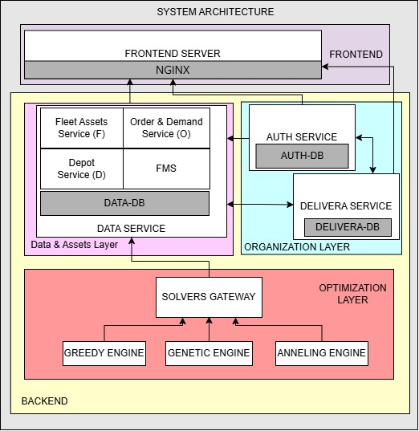

# Delivera Architecture Documentation

## Languages

- EN [English Version](#en)
- ES [Versión en Español](#es)

---
# EN

## Table of Contents

- [General Architecture](#general-architecture)
- [Frontend Layer](#frontend-layer)
- [Data & Assets Layer](#data--assets-layer)
  - [FMS Module](#fms-module)
- [Organization Layer](#organization-layer)
  - [auth-service](#auth-service)
  - [delivera-service](#delivera-service)
- [SPACE Integration](#space-integration)
- [Optimization Layer](#optimization-layer)
- [Internal Communications](#internal-communications)
- [Certificates and Key Rotation](#certificates-and-key-rotation)
- [Architectural Considerations](#architectural-considerations)

# General Architecture

The following diagram illustrates a high-level view of the current Delivera architecture.



Delivera is based on a microservice architecture organized into several functional layers. Each layer is responsible for a specific set of functionalities and communicates with the rest of the system through well-defined interfaces.

At a high level, the platform is composed of the following layers:

- Frontend Layer
- Data & Assets Layer
- Organization Layer
- Optimization Layer

This separation improves responsibility isolation, simplifies component maintenance, and enables services to evolve independently.

---

# Frontend Layer

The frontend layer is composed of:

- Frontend Application
- NGINX

NGINX acts as the single entry point to the system and operates as a reverse proxy for all incoming client communications.

This approach provides several advantages:

- Centralized access management.
- Simplified network configuration.
- Ability to apply common security policies.
- Concealment of the internal backend topology.

External clients interact exclusively with NGINX and do not have direct access to internal microservices.

---

# Data & Assets Layer

This layer contains the primary business service of the platform: `data-service`.

Its main responsibility is the storage and management of operational information used by the system.

Managed data includes:

- Orders.
- Vehicles.
- Operational units.
- Depots.
- Planning preferences.

Information is stored in a dedicated database called `DATA-DB`.

## FMS Module

The `data-service` also contains the FMS (Fleet Management System) module.

This module implements the complete workflow required to solve logistics optimization problems based on MD-CVRP (Multi Depot Capacitated Vehicle Routing Problem).

The process is divided into three main stages.

### Instance Preparation

The first stage consists of collecting all information required to build a problem instance.

Data may originate from:

- Orders registered in the system.
- Available vehicles.
- Operational units.
- Associated depots.
- Standard benchmark instances provided by the solvers gateway.

### Clustering

Once an instance has been generated, a clustering process is executed.

The objective of this phase is to reduce the effective size of the search space by generating smaller subproblems.

This provides several advantages:

- Reduced execution times.
- Improved scalability.
- Easier resolution of large problem instances.

### Solving Phase

Finally, the generated instances are sent to the optimization layer through requests to the solvers gateway.

The results returned by the optimization engines are then integrated back into the system.

---

# Organization Layer

The organization layer is composed of two closely related microservices:

- auth-service
- delivera-service

Both services currently maintain independent databases:

- AUTH-DB
- DELIVERA-DB

Although this separation provides security and responsibility isolation benefits, there is a significant level of functional coupling between both services.

## auth-service

This service is responsible for authentication and authorization processes.

It manages:

- User login.
- User registration.
- Session refresh.
- Active company switching.
- JWT generation.
- Refresh token management.

### Authentication Strategy

The platform uses:

- Short-lived JWT tokens.
- Long-lived refresh tokens.

JWTs are signed using RSA-256 and stored in the browser Local Storage.

Refresh tokens are stored in cookies and are composed of two UUID values separated by a dot (`.`).

Each refresh token contains:

- A maximum expiration date.
- A renewable expiration period extended through valid usage.

## delivera-service

This service stores the organizational information of the platform.

It manages:

- Organizations.
- Companies.
- Workers.
- User information.

Part of the information required to build JWT claims is stored exclusively in this service.

For this reason, operations such as:

- Login.
- Refresh Token.
- Switch Company.

require communication between `auth-service` and `delivera-service`.

### Credential Separation

The separation between both services also provides additional security benefits.

In the event of a compromise affecting the authentication database:

- An attacker does not gain access to all user information.
- Passwords remain encrypted.
- Refresh token information remains protected.

---

# Optimization Layer

The optimization layer contains the solving engines used by the platform.

It is currently composed of:

- Solvers Gateway
- Greedy Engine
- Genetic Engine
- Annealing Engine

The gateway acts as a single access point to all optimization engines.

The engines implement a common contract, enabling algorithms to be exchanged without modifying the rest of the platform.

Communication with this layer currently uses HTTP.

Due to deployment requirements, the solvers operate in an isolated network and are accessed through:

```text
host.docker.internal
```

Detailed information regarding this architecture can be found in the `Solver-FMS` project, where the internal architecture and common contract used by the optimization engines are documented.
---

# SPACE Integration

Delivera depends on SPACE for quota validation and resource consumption management across multiple services.

Currently, both `delivera-service` and `data-service` integrate with SPACE to register and validate resource consumption associated with organizations, companies and operational features.

This integration is considered a critical dependency of the platform because several business operations require quota validation before they can be executed.

## Authentication

Communication with SPACE requires a valid `SPACE-API-KEY`.

Due to the variety of operations performed by the platform, Delivera requires a SPACE API key with the following permission level:

```text
ALL
```

This API key is used by multiple services to:

- Validate subscription limits.
- Register resource consumption.
- Update consumption records.
- Execute quota-related operations.

## Startup Validation

SPACE integration is mandatory for the correct operation of the platform.

As a result:

- `delivera-service` requires a valid SPACE API key.
- `data-service` requires a valid SPACE API key.

If the configured API key is missing or invalid, the affected service will fail during startup and will not become available.

This design decision ensures that the platform cannot operate in an inconsistent state where quota validation or consumption tracking is unavailable.

## Operational Considerations

Since SPACE is a critical external dependency, its availability directly affects several business operations within the platform.

For this reason, it is recommended to:

- Properly configure the required API key before deployment.
- Validate connectivity to SPACE during environment setup.
- Monitor SPACE availability as part of the platform infrastructure.

---

# Internal Communications

Communications between microservices use Mutual TLS (mTLS).

This mechanism provides:

- Encrypted communications.
- Server authentication.
- Client authentication.
- Protection against unauthorized services.

Currently, all internal layers use mTLS except the optimization layer, which still uses HTTP due to the current deployment architecture.

---

# Certificates and Key Rotation

Delivera includes automation tools designed to simplify operational security tasks.

These utilities include:

- Generation of mTLS certificates.
- Creation of truststores and keystores.
- Rotation of RSA keys used to sign JWTs.
- Environment certificate updates.

Detailed documentation for these procedures can be found in:

```text
deployment_guide.md
```

---

# Architectural Considerations

The current architecture has been designed with the following priorities:

- Separation of concerns.
- Service-to-service security.
- Scalability.
- Maintainability.
- Compatibility with interchangeable optimization engines.

However, there is a significant functional dependency between `auth-service` and `delivera-service`. Future versions may evaluate a partial consolidation of these domains or a redefinition of their bounded contexts in order to reduce recurring

---
# ES

# Versión en Español

## Índice

- [Arquitectura General](#arquitectura-general)
- [Frontend Layer](#frontend-layer-1)
- [Data & Assets Layer](#data--assets-layer-1)
  - [Módulo FMS](#módulo-fms)
- [Organization Layer](#organization-layer-1)
  - [auth-service](#auth-service-1)
  - [delivera-service](#delivera-service-1)
- [Integración con SPACE](#integración-con-space)
- [Optimization Layer](#optimization-layer-1)
- [Comunicaciones Internas](#comunicaciones-internas)
- [Certificados y Rotación de Claves](#certificados-y-rotación-de-claves)
- [Consideraciones Arquitectónicas](#consideraciones-arquitectónicas)

---

# Arquitectura General

La siguiente imagen muestra una representación de alto nivel de la arquitectura actual de Delivera.


Delivera está basado en una arquitectura de microservicios organizada en varias capas funcionales. Cada capa es responsable de un conjunto específico de funcionalidades y se comunica con el resto del sistema mediante interfaces bien definidas.

A nivel general, la plataforma se compone de las siguientes capas:

- Frontend Layer
- Data & Assets Layer
- Organization Layer
- Optimization Layer

Esta separación permite mantener un mayor aislamiento entre responsabilidades, facilita el mantenimiento de los componentes y permite evolucionar cada servicio de manera independiente.

---

# Frontend Layer

La capa de frontend está formada por:

- Frontend Application
- NGINX

NGINX actúa como punto único de entrada al sistema y funciona como reverse proxy para todas las comunicaciones procedentes del cliente.

Esta aproximación aporta varias ventajas:

- Centralización de los puntos de acceso.
- Simplificación de la configuración de red.
- Posibilidad de aplicar reglas de seguridad comunes.
- Ocultación de la topología interna del backend.

Los clientes externos únicamente interactúan con NGINX, sin acceso directo a los microservicios internos.

---

# Data & Assets Layer

Esta capa contiene el principal servicio de negocio de la aplicación: `data-service`.

Su responsabilidad principal es almacenar y gestionar la información operativa utilizada por el sistema.

Entre los datos gestionados destacan:

- Órdenes.
- Vehículos.
- Unidades operativas.
- Depósitos.
- Preferencias de planificación.

La información se almacena en una base de datos dedicada denominada `DATA-DB`.

## Módulo FMS

Dentro de `data-service` se encuentra integrado el módulo FMS (Fleet Management System).

Este módulo implementa el flujo completo necesario para resolver problemas de optimización logística basados en MD-CVRP (Multi Depot Capacitated Vehicle Routing Problem).

El proceso se divide en tres fases principales.

### Preparación de instancias

La primera fase consiste en recopilar toda la información necesaria para generar una instancia del problema.

Los datos pueden proceder de:

- Órdenes registradas en el sistema.
- Vehículos disponibles.
- Unidades operativas.
- Depósitos asociados.
- Instancias estándar proporcionadas por el gateway de los solvers.

### Clusterización

Una vez generada la instancia, se ejecuta un proceso de clusterización.

El objetivo de esta fase es reducir el tamaño efectivo del espacio de búsqueda generando subproblemas más pequeños.

Esto permite:

- Reducir tiempos de ejecución.
- Mejorar la escalabilidad.
- Facilitar la resolución de grandes instancias.

### Resolución

Finalmente, las instancias generadas son enviadas a la capa de optimización mediante peticiones al gateway de los solvers.

Los resultados devueltos por los motores de resolución son posteriormente integrados en el sistema.

---

# Organization Layer

La capa de organización está formada por dos microservicios estrechamente relacionados:

- auth-service
- delivera-service

Actualmente ambos servicios poseen bases de datos independientes:

- AUTH-DB
- DELIVERA-DB

Aunque esta separación aporta ventajas de seguridad y aislamiento de responsabilidades, existe un elevado nivel de acoplamiento funcional entre ambos servicios.

## auth-service

Este servicio es responsable del proceso de autenticación y autorización.

Gestiona:

- Login.
- Registro de usuarios.
- Refresh de sesiones.
- Cambio de empresa activa.
- Emisión de JWT.
- Gestión de refresh tokens.

### Estrategia de autenticación

El sistema utiliza:

- JWT de corta duración.
- Refresh tokens de larga duración.

Los JWT se firman utilizando RSA-256 y se almacenan en el navegador mediante Local Storage.

Los refresh tokens se almacenan mediante cookies y están compuestos por dos UUID separados mediante un carácter punto (`.`).

Cada refresh token mantiene:

- Fecha máxima de expiración.
- Fecha de expiración renovable mediante uso.

## delivera-service

Este servicio almacena la información organizativa del sistema.

Gestiona:

- Organizaciones.
- Empresas.
- Trabajadores.
- Información de usuarios.

Parte de la información necesaria para construir los JWT reside exclusivamente en este servicio.

Por este motivo, durante operaciones como:

- Login.
- Refresh Token.
- Switch Company.

es necesario realizar comunicaciones entre `auth-service` y `delivera-service`.

### Separación de credenciales

La separación entre ambos servicios constituye además una medida adicional de seguridad.

En caso de compromiso de la base de datos de autenticación:

- El atacante no dispone de toda la información del usuario.
- Las contraseñas permanecen cifradas.
- Los refresh tokens permanecen protegidos.

---

# Optimization Layer

La capa de optimización contiene los distintos motores de resolución utilizados por el sistema.

Actualmente está formada por:

- Solvers Gateway
- Greedy Engine
- Genetic Engine
- Annealing Engine

El gateway actúa como punto único de acceso a los motores de optimización.

Los motores implementan un contrato común que permite intercambiar algoritmos sin modificar el resto del sistema.

Actualmente la comunicación con esta capa se realiza mediante HTTP.

Debido a requisitos de despliegue, los solvers se encuentran en una red independiente y son accesibles a través de:

```text
host.docker.internal
```

La información detallada relativa a esta arquitectura puede consultarse en el proyecto `Solver-FMS`, donde se documenta la implementación de los distintos motores de optimización y su contrato común.

---

---

# Integración con SPACE

Delivera depende de SPACE para la validación de cuotas y la gestión del consumo de recursos en varios servicios de la plataforma.

Actualmente, tanto `delivera-service` como `data-service` utilizan SPACE para registrar y validar consumos asociados a organizaciones, empresas y funcionalidades operativas.

Esta integración se considera una dependencia crítica del sistema, ya que numerosas operaciones de negocio requieren validar previamente los límites contratados antes de poder ejecutarse.

## Autenticación

La comunicación con SPACE requiere una `SPACE-API-KEY` válida.

Debido a la variedad de operaciones realizadas por la plataforma, Delivera requiere una clave de tipo:

```text
ALL
```

Esta clave es utilizada por varios servicios para:

- Validar límites de suscripción.
- Registrar consumos de recursos.
- Actualizar consumos existentes.
- Ejecutar operaciones relacionadas con cuotas y capacidades.

## Validación durante el arranque

La integración con SPACE es obligatoria para el correcto funcionamiento de la plataforma.

Por este motivo:

- `delivera-service` requiere una SPACE API Key válida.
- `data-service` requiere una SPACE API Key válida.

Si la clave configurada no existe o es inválida, el servicio afectado fallará durante el arranque y no estará disponible.

Esta decisión de diseño garantiza que la plataforma no pueda ejecutarse en un estado inconsistente donde las validaciones de cuota y el control de consumos no puedan realizarse correctamente.

## Consideraciones Operativas

Dado que SPACE constituye una dependencia externa crítica, su disponibilidad afecta directamente a diversas operaciones de negocio de la plataforma.

Por ello se recomienda:

- Configurar correctamente la API Key antes del despliegue.
- Verificar la conectividad con SPACE durante la configuración del entorno.
- Monitorizar la disponibilidad de SPACE como parte de la infraestructura del sistema.


# Comunicaciones Internas

Las comunicaciones entre microservicios utilizan Mutual TLS (mTLS).

Este mecanismo proporciona:

- Cifrado de las comunicaciones.
- Validación del servidor.
- Validación del cliente.
- Protección frente a servicios no autorizados.

Actualmente todas las capas internas utilizan mTLS excepto la capa de optimización, que todavía utiliza HTTP debido a las características actuales de despliegue.

---

# Certificados y Rotación de Claves

Delivera incorpora herramientas de automatización para simplificar las tareas operativas relacionadas con la seguridad.

Entre estas utilidades se incluyen:

- Generación de certificados para mTLS.
- Creación de truststores y keystores.
- Rotación de claves RSA utilizadas para firmar JWT.
- Actualización de certificados del entorno.

La documentación detallada de estos procedimientos puede consultarse en:

```text
deployment_guide.md
```

---

# Consideraciones Arquitectónicas

La arquitectura actual ha sido diseñada priorizando:

- Separación de responsabilidades.
- Seguridad entre servicios.
- Escalabilidad.
- Mantenibilidad.
- Compatibilidad con motores de optimización intercambiables.

No obstante, existe un elevado grado de dependencia funcional entre `auth-service` y `delivera-service`, por lo que futuras versiones podrían evaluar una consolidación parcial de ambos dominios o una reorganización de sus límites de contexto para reducir comunicaciones internas recurrentes.